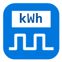

# ioBroker.espeasy-s0

**Zuverlässiges Auslesen von S0-Energiezählern (z. B. Eltako DSZ12E, WSZ, DSZ15…) über einen ESP8266/ESP32 mit [ESPEasy](https://espeasy.readthedocs.io/).**

*English below.*

## Warum?

Der ESPEasy-Pulse-Counter zählt die S0-Impulse zuverlässig. Sein Wert `Total` ist aber **kein Zählerstand**: Nach einem Stromausfall, einem Neu-Flashen oder einem Reset fängt er wieder bei 0 an. Dieser Adapter nimmt deshalb nur die **Differenzen** zwischen zwei Abfragen und führt den Zählerstand selbst in ioBroker weiter.

- neustartsicher: ESP-Neustarts und Zähler-Resets werden erkannt, es gehen keine Impulse verloren
- Zählerstand auf den Wert des echten Zählers setzbar (`meter.setReading`)
- aktuelle Leistung in W, berechnet aus dem Impulsabstand
- Verbrauch heute, gestern, diesen Monat, letzten Monat, dieses Jahr, letztes Jahr
- Plausibilitätsfilter gegen Störimpulse
- Erreichbarkeit und Diagnose pro Gerät, mehrere Geräte pro Instanz
- keine Cloud und kein MQTT nötig, der Adapter fragt `http://<ESP>/json` direkt ab

## ESPEasy einrichten

1. Unter *Devices* einen Task **Generic - Pulse counter** anlegen
2. Verdrahtung: **S0+ an den GPIO, S0- an GND**. Den GPIO auswählen und *Internal PullUp* aktivieren.
3. **Counter Type:** `Delta/Total/Time`
4. **Mode Type:** `Falling`. Nicht `Change`, sonst werden pro Impuls zwei Flanken gezählt.
5. **Debounce Time:** z. B. **100 ms**. Der Wert muss über eventuellen Störflanken liegen: Am Eltako DSZ12E wurde etwa 34 ms nach dem Impuls eine zweite Flanke gemessen, mit 30 ms wurde dann doppelt gezählt. Gleichzeitig muss er unter dem kleinsten Impulsabstand bei Höchstlast bleiben. 100 ms reichen bei 800 Imp/kWh bis 45 kW.
6. Interval z. B. 2–10 s, Task aktivieren

Mit dem Adapter ist ein MQTT-Controller in ESPEasy nicht erforderlich. Ein vorhandener stört aber nicht.

## Adapter einrichten

| Feld | Bedeutung |
|---|---|
| Name | wird zur Objekt-ID, z. B. `Heizung` → `espeasy-s0.0.Heizung.*` |
| IP / Host | Adresse des ESP, z. B. `10.0.50.147` |
| ESPEasy-Taskname | Name des Pulse-Counter-Tasks; leer = erster Pulse-Counter |
| Impulse / kWh | steht auf dem Zähler, z. B. `800` beim Eltako DSZ12E |
| Zählerstand setzen (kWh) | Stand des echten Zählers, z. B. `70002`. Wird **einmal** übernommen, wenn der Wert neu eingetragen oder geändert wird. Ein späteres Speichern der Einstellungen setzt den Zähler also nicht zurück. Leer bedeutet: nichts setzen. |
| Time-Datenpunkt (optional) | z. B. `mqtt.0.<Gerät>.<Task>.Time`, wenn der ESP zusätzlich per MQTT an ioBroker sendet. Dann wird die Leistung **exakt aus jedem Impulsabstand** berechnet, genau wie im ESP gemessen. Ohne den Datenpunkt schätzt der Adapter die Leistung aus den Abfragen. Für eine gute Genauigkeit sollte das Abfrageintervall dann bei 2 s liegen. |
| Wert 'Total' / 'Time' | Namen der Task-Werte, nur ändern, wenn in ESPEasy umbenannt |

Den **Stand des echten Zählers** trägst du in den Instanz-Einstellungen ein (Spalte „Zählerstand setzen“) oder schreibst ihn in `espeasy-s0.0.<Name>.meter.setReading`, z. B. `70002`. Ab dann zählt der Adapter weiter. Den Abgleich kannst du jederzeit wiederholen. Der laufende Tages-, Monats- und Jahresverbrauch ändert sich dadurch nicht.

## Datenpunkte

| Datenpunkt | Beschreibung |
|---|---|
| `meter.total_kWh` | Zählerstand in kWh |
| `meter.power_W` | aktuelle Leistung in W |
| `meter.setReading` | Zählerstand setzen (schreibbar) |
| `consumption.today_kWh` / `yesterday_kWh` | Verbrauch heute / gestern |
| `consumption.month_kWh` / `lastMonth_kWh` | Verbrauch dieser / letzter Monat |
| `consumption.year_kWh` / `lastYear_kWh` | Verbrauch dieses / letztes Jahr |
| `info.online` | ESP erreichbar |
| `info.powerSource` | `mqtt` = exakter Impulsabstand, `poll` = Schätzung aus den Abfragen |
| `info.lastUpdate` / `info.lastPulse` | Zeitpunkt der letzten Abfrage / des letzten Impulses |
| `info.espTotal` / `info.espUptime` | Rohwert und Laufzeit des ESP |
| `info.rebootCount` / `counterResetCount` / `rejectedCount` | Diagnose-Zähler |
| `internal.state` | gespeicherter Zustand, bitte nicht ändern |

## Sicherung

Löscht man eine Instanz, entfernt ioBroker auch alle ihre Datenpunkte, also Zählerstand und Verbrauchswerte. Deshalb legt der Adapter (abschaltbar in den Einstellungen) zusätzlich eine Sicherung an:

- Datei `0_userdata.0/espeasy-s0/<Gerät>.json` in den ioBroker-Dateien. Sie bleibt beim Löschen der Instanz erhalten und wird von BackItUp mitgesichert.
- Geschrieben wird sie alle 5 Minuten, beim Tageswechsel, beim Setzen des Zählerstands und beim Stoppen des Adapters.
- Startet eine Instanz **ohne eigenen Zustand**, z. B. nach einer Neuinstallation, stellt sie Zählerstand und Verbrauch automatisch daraus wieder her und schreibt das als Warnung ins Log. Ein in den Einstellungen geänderter Zählerstand hat Vorrang.
- Wer bewusst bei 0 anfangen will, löscht die Datei vorher, z. B. über Admin → Dateien → `0_userdata.0`.

Beim Wiederherstellen aus einer ioBroker-Sicherung mit BackItUp bleibt ohnehin alles erhalten, auch der interne Zustand der Instanz.

## Grenzen

- Impulse, die der ESP zwischen der letzten Abfrage und einem **Stromausfall** gezählt hat, gehen verloren, maximal ein Abfrageintervall. Ein kürzeres Abfrageintervall verringert das.
- Fällt nur ioBroker oder das WLAN aus, zählt der ESP weiter. Der Adapter übernimmt die Impulse danach vollständig.
- Ist in ESPEasy ein Admin-Passwort gesetzt, muss `/json` ohne Anmeldung erreichbar sein (wird noch nicht unterstützt).

---

## English

Reliable reading of S0 energy meters through an ESPEasy *Generic - Pulse counter* task. The adapter polls `http://<esp>/json`, adds only the differences of the ESP's `Total` value to its own persistent counter, and therefore survives ESP reboots and counter resets. It provides the meter reading (kWh), current power (W), consumption for today, yesterday, month, last month, year and last year, a plausibility filter, and reachability and diagnostics.

ESPEasy settings: counter type `Delta/Total/Time`, mode type `Falling`, debounce e.g. 100 ms (above contact bounce, below the shortest pulse interval at full load). In the adapter, configure the IP, task name and impulses per kWh, and enter the reading of your physical meter in the instance settings (or write it to `meter.setReading`). Meter reading and consumption are also backed up to `0_userdata.0/espeasy-s0/<device>.json` and restored automatically when a new instance starts without its own state.

## Changelog
<!--
    Placeholder for the next version (at the beginning of the line):
    ### **WORK IN PROGRESS**
-->
### 0.3.0 (2026-11-18)
* (BeSiRe1) backup of meter reading and consumption to 0_userdata.0, automatically restored after deleting/re-installing the instance

### 0.2.0 (2026-11-18)
* (BeSiRe1) exact power from every pulse interval via optional MQTT Time state
* (BeSiRe1) power only decays when the next pulse is overdue (no more jumping values)
* (BeSiRe1) spurious pulse intervals (contact bounce) are ignored
* (BeSiRe1) new state info.powerSource
* (BeSiRe1) meter reading can be set in the instance settings (applied once per entered value)

### 0.1.0 (2026-11-17)
* (BeSiRe1) initial release

## License
MIT License

Copyright (c) 2026 BeSiRe1
